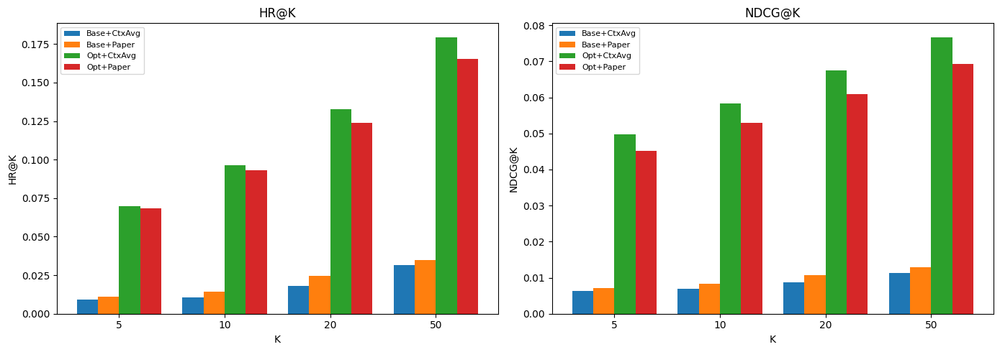
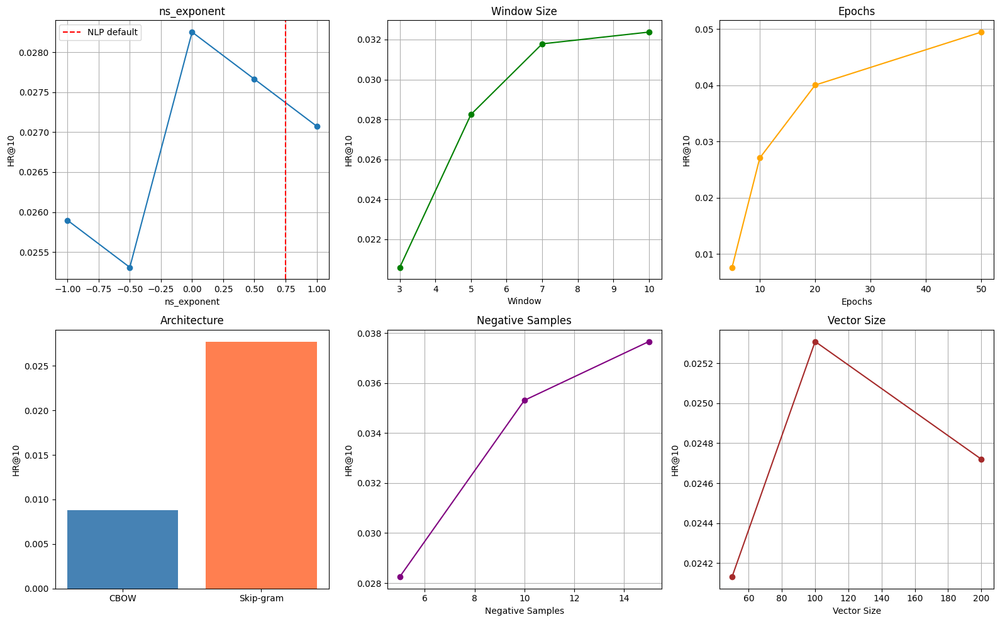
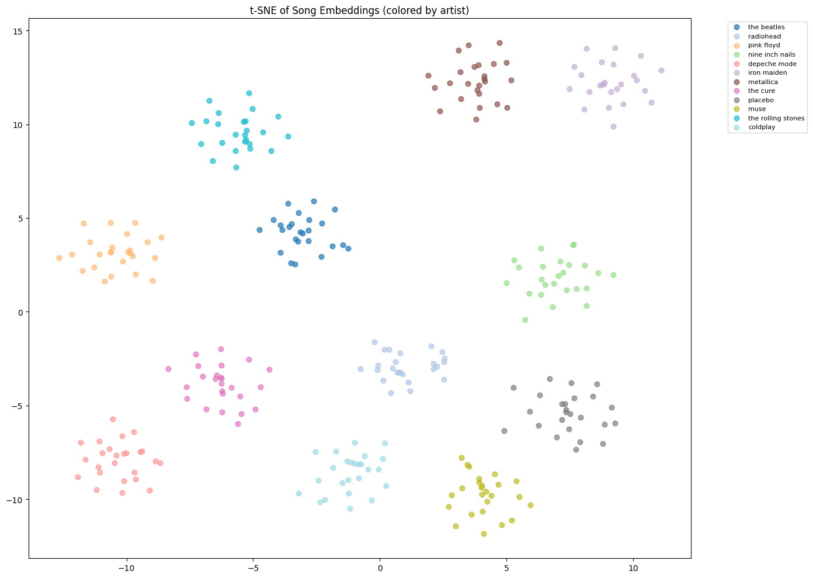
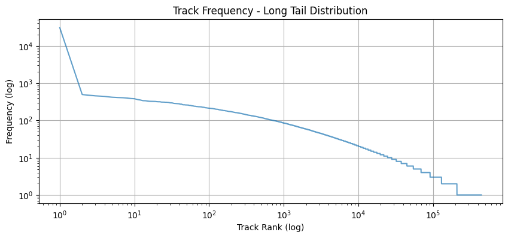

# Song2Vec: Music Recommendation with Word2Vec

Track embeddings learned from 47,130 Last.fm playlists with Word2Vec, tuned for recommendation and evaluated on next-track prediction.

## Highlights

- Learns track embeddings with Gensim Word2Vec by treating playlists as sentences and tracks as words
- Runs one-at-a-time sweeps over seven hyperparameters, following [Caselles-Dupré et al. (2018)](https://arxiv.org/abs/1804.04212)
- Tuning raised single-query HR@10 from 0.0145 with NLP defaults to 0.0930 (+541.4%)
- Evaluates with HR@K and NDCG@K under two query strategies, plus nearest-neighbour, song-algebra and t-SNE checks
- Includes a multi-seed recommender, cold-start and popularity analysis, and a failure analysis with proposed fixes

## Overview

Word2Vec learns that two words are similar when they appear in similar contexts. The same idea applies to music: tracks that often share a playlist are likely to suit the same listener. This project trains Word2Vec on playlists from the 30Music dataset and uses the resulting embeddings to predict the next track in a playlist, retrieve similar songs and recommend tracks from a set of seeds.

Caselles-Dupré et al. (2018), [*Word2Vec applied to Recommendation: Hyperparameters Matter*](https://arxiv.org/abs/1804.04212), show that the defaults used for NLP are far from optimal for recommendation. This project tests that claim on 30Music by comparing a baseline with NLP defaults against a configuration tuned through systematic sweeps.

## Dataset

[30Music](https://remaplab.deib.polimi.it/resources/) (Turrin et al., 2015) is a collection of listening sessions and playlists gathered from Last.fm. This project uses `playlist.idomaar` (playlists as lists of track IDs) and `tracks.idomaar` (track metadata in `Artist/_/Title` form).

| Statistic | Value |
|---|---|
| Tracks parsed from `tracks.idomaar` | 4,519,105 |
| Playlists with at least 2 resolvable tracks | 47,130 |
| Track occurrences across playlists | 1,601,748 |
| Unique tracks | 444,075 |
| Unique artists | 60,184 |
| Train / test playlists (80/20 split) | 37,704 / 9,426 |
| Playlist length (mean / median / max) | 34.0 / 15 / 200 |

The dataset is not included in this repository. Download it from the official source and follow its terms of use.

## Approach

```mermaid
flowchart LR
    A[tracks.idomaar] --> C[artist__title tokens]
    B[playlist.idomaar] --> D[Playlists as token sequences]
    C --> D
    D --> E[80/20 split by playlist]
    E --> F[Word2Vec baseline and sweeps]
    F --> G[Tuned model]
    G --> H[HR@K / NDCG@K evaluation]
    G --> I[Recommender and analysis]
```

1. **Parsing.** Track names are URL-decoded, split into artist and title, and normalized into `artist__title` tokens. Each playlist becomes a sequence of these tokens.
2. **Baseline.** Skip-gram with NLP defaults: `window=5`, `ns_exponent=0.75`, `negative=5`, `min_count=5`, `vector_size=100`, `epochs=5`.
3. **Sweeps.** One parameter is varied at a time and scored by single-query HR@10 on 2,000 test playlists. Swept values: `ns_exponent` {-1, -0.5, 0, 0.5, 1}, `window` {3, 5, 7, 10}, `epochs` {5, 10, 20, 50}, architecture {CBOW, skip-gram}, `negative` {5, 10, 15}, `min_count` {3, 5, 10}, `vector_size` {50, 100, 200}.
4. **Tuned model.** Combines the best value from each sweep.
5. **Evaluation.** HR@K and NDCG@K for K = 5, 10, 20, 50 on 2,000 test playlists. The last track is the target. The query is either the previous track (single query, as in the paper) or the mean embedding of all previous tracks (context average).
6. **Analysis.** Nearest neighbours, song algebra, t-SNE, a multi-seed recommender, cold-start coverage, and HR@10 by target popularity.

## Results

Next-track prediction on 2,000 test playlists:

| Model | Query strategy | HR@5 | HR@10 | HR@20 | HR@50 | NDCG@10 |
|---|---|---|---|---|---|---|
| Baseline | Context average | 0.0090 | 0.0105 | 0.0180 | 0.0315 | 0.0068 |
| Baseline | Single query | 0.0110 | 0.0145 | 0.0245 | 0.0350 | 0.0082 |
| Tuned | Context average | **0.0700** | **0.0965** | **0.1325** | **0.1795** | **0.0584** |
| Tuned | Single query | 0.0685 | 0.0930 | 0.1240 | 0.1655 | 0.0530 |

The tuned configuration is `ns_exponent=0`, `window=10`, `epochs=50`, skip-gram, `negative=15`, `min_count=10`, `vector_size=100`, with a vocabulary of 21,393 tracks.

Hyperparameter sweeps (single-query HR@10, one parameter varied at a time):

| Parameter | HR@10 by value | Best |
|---|---|---|
| `epochs` | 5: 0.0077 · 10: 0.0271 · 20: 0.0400 · 50: 0.0494 | 50 |
| `min_count` | 3: 0.0146 · 5: 0.0288 · 10: 0.0537 | 10 |
| `negative` | 5: 0.0283 · 10: 0.0353 · 15: 0.0377 | 15 |
| `window` | 3: 0.0206 · 5: 0.0283 · 7: 0.0318 · 10: 0.0324 | 10 |
| Architecture | CBOW: 0.0088 · skip-gram: 0.0277 | skip-gram |
| `ns_exponent` | -1.0: 0.0259 · -0.5: 0.0253 · 0: 0.0283 · 0.5: 0.0277 · 1.0: 0.0271 | 0 |
| `vector_size` | 50: 0.0241 · 100: 0.0253 · 200: 0.0247 | 100 |

HR@10 by how often the target track appears in training (tuned model, single query):

| Target popularity | HR@10 | Evaluated cases |
|---|---|---|
| Rare (fewer than 10) | n/a | 0 |
| Medium (10–100) | 0.1014 | 1,262 |
| Frequent (over 100) | 0.0714 | 266 |

Cold start: only 4.8% of unique tracks (21,393 of 444,075) pass `min_count=10`, and 87.5% of unique test tracks are out of vocabulary. An artist-level fallback (the mean embedding of an artist's known tracks) would cover 50.0% of those out-of-vocabulary tracks.


*HR@K and NDCG@K for the baseline and tuned models under both query strategies.*


*Single-query HR@10 for each hyperparameter sweep; the dashed line marks the NLP default `ns_exponent=0.75`.*


*t-SNE of tuned-model embeddings for the 12 artists with the most tracks in the vocabulary; tracks by the same artist form tight clusters.*


*Track frequency by rank (log-log): a power-law long tail, with one extreme outlier at the top.*

## Key findings

- **Training length and vocabulary threshold matter most.** `epochs` (0.0077 to 0.0494) and `min_count` (0.0146 to 0.0537) drove the largest gains. `ns_exponent`, the key parameter in the paper, varied by only about 0.003. A likely reason is an extreme outlier in the data: one track appears 31,036 times, over 60x the next most frequent track, which distorts negative sampling.
- **The better query strategy depends on embedding quality.** Context averaging wins with the tuned model (HR@10 0.0965 vs. 0.0930) but loses with the baseline (0.0105 vs. 0.0145). Averaging helps when the embeddings are good and adds noise when they are not.
- **Medium-frequency tracks are easier to predict than very popular ones** (HR@10 0.1014 vs. 0.0714). Popular tracks appear in so many different playlists that their embeddings become generic.
- **Artist over-representation is the main failure mode.** Single-seed neighbour lists are almost entirely by the seed's artist. Multi-seed queries already diversify the results, and capping each artist at 2–3 tracks per list is a simple post-processing fix.

## Tech stack

Python 3.12, Gensim 4.4 (Word2Vec), NumPy, scikit-learn (train/test split, t-SNE), Matplotlib, tqdm, Jupyter / Google Colab

## Project structure

```
song2vec-recommender/
├── song2vec_recommender.ipynb   # Full pipeline: parsing, EDA, training, sweeps, evaluation, recommender
├── figures/                     # Figures used in this README
├── requirements.txt
└── README.md
```

## How to run

1. Clone the repository and install the dependencies:

   ```bash
   git clone https://github.com/efe-akpinar/song2vec-recommender.git
   cd song2vec-recommender
   python -m venv .venv && source .venv/bin/activate
   pip install -r requirements.txt jupyter
   ```

2. Download the 30Music dataset from the [official source](https://remaplab.deib.polimi.it/resources/) and place `playlist.idomaar` and `tracks.idomaar` in a `data/` folder:

   ```
   data/
   ├── playlist.idomaar
   └── tracks.idomaar
   ```

   To keep the files elsewhere, change `PLAYLIST_FILE` and `TRACKS_FILE` in the notebook's setup cell.

3. Open and run the notebook:

   ```bash
   jupyter notebook song2vec_recommender.ipynb
   ```

The sweeps train 26 Word2Vec models, including a 50-epoch run, so a full run takes a while. Seed 42 is used throughout, but training uses 4 worker threads, so scores may differ slightly between runs.
